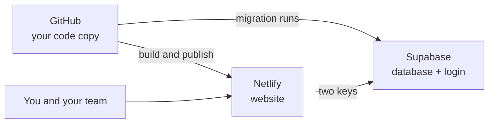

<div align="center">

# Deploy Guide

**Go live without installing anything on your computer.**

[](#step-1--copy-the-code)
[](#step-2--create-the-database)
[](#step-4--publish-the-website)
[](LICENSE)

[Overview](#overview) · [Step 1](#step-1--copy-the-code) · [Step 2](#step-2--create-the-database) · [Step 3](#step-3--set-the-manager) · [Step 4](#step-4--publish-the-website) · [Step 5](#step-5--connect-the-site-back-to-supabase) · [Troubleshooting](#troubleshooting) · [Updates](#getting-future-updates)

</div>

---

## Overview

You need only a web browser and three free accounts: **GitHub**, **Supabase**, and **Netlify**.

There is no separate backend server. **Supabase is the backend** (database and login system). You connect your code copy to Supabase once, and it builds the whole database automatically.



| Step | What you do | Where |
| :-: | --- | --- |
| 1 | Copy the code | GitHub |
| 2 | Create the database (it builds itself) | Supabase |
| 3 | Set the manager email | Supabase |
| 4 | Publish the website and add two keys | Netlify |
| 5 | Connect the site address back and sign in | Supabase, Browser |

> [!IMPORTANT]
> Keep these things ready before you start: a database password you can save safely, and the email address of the person who will be the Manager.

### Checklist

- [ ] GitHub account
- [ ] Supabase account
- [ ] Netlify account
- [ ] Manager email address
- [ ] Company email domain (for example `yourcompany.com`)

---

## Step 1 — Copy the code

**Where: GitHub**

1. Open this repository on GitHub.
2. Click **Use this template → Create a new repository** (or **Fork**).
3. Give it any name, for example `my-workforce`.
4. Choose **Private** if you want. Nobody can see your code and everything still works.
5. Click **Create repository**.

> [!TIP]
> **Fork or template?** A **Fork** has a one-click **Sync fork** button for future updates. A **template copy** has no sync button. If updates matter to you, pick **Fork**. See [Getting future updates](#getting-future-updates).

> [!NOTE]
> If you own the original repository and want others to see the **Use this template** button, open **Settings → General → Template repository** and tick the box.

---

## Step 2 — Create the database

**Where: Supabase**

### 2.1 Create the project

1. Go to [supabase.com](https://supabase.com) and sign in.
2. Click **New project**.
3. Fill in:

   | Field | What to enter |
   | --- | --- |
   | Name | Any name, for example `workforce` |
   | Database password | A strong password. **Save it somewhere safe** |
   | Region | The one closest to your team |

4. Click **Create new project** and wait until it is ready.

### 2.2 Connect your GitHub copy

1. Inside the project, open **Project Settings** (gear icon) **→ Integrations**.
2. Under **GitHub Integration**, click **Authorize GitHub**.
3. On the GitHub page, click **Authorize Supabase**.
4. Back in Supabase, choose your copied repository from the list.
5. Set **Working directory** to `.` (a single dot).
6. Turn on **Deploy to production**.
7. Click **Enable integration**.

> [!IMPORTANT]
> You never open the SQL Editor and never paste any code. Supabase finds `supabase/migrations/20261024000000_init.sql` in your repository and runs it by itself. All tables, rules, and login logic are created automatically.

### 2.3 Check that it finished

Open **Project Settings → Integrations** and look at the deployment status. When it shows as successful, the **Table Editor** lists tables such as `settings`.

---

## Step 3 — Set the manager

**Where: Supabase · No code**

Before anyone can sign in, the database must know who the Manager is.

1. In Supabase, open **Table Editor** (table icon on the left).
2. Open the **`settings`** table. It has exactly one row. Click it to edit.
3. Fill in two fields:

   | Field | Example | Meaning |
   | --- | --- | --- |
   | `bootstrap_email` | `manager@yourcompany.com` | This person **must sign in first**. Their account automatically becomes the Manager |
   | `allowed_domains` | `{yourcompany.com}` | Only emails from these domains can create an account. Keep the curly brackets. Leave `{}` empty to allow everybody after the manager exists |

4. Click **Save**.

> [!WARNING]
> Type `allowed_domains` with curly brackets, like `{yourcompany.com}`. For several domains, separate them with commas: `{yourcompany.com,partner.com}`.

---

## Step 4 — Publish the website

**Where: Netlify**

### 4.1 Import the repository

1. Go to [netlify.com](https://netlify.com) and sign in.
2. Click **Add new site → Import an existing project**.
3. Choose **GitHub**, then pick your copied repository.
4. The build settings come from `netlify.toml`. Just confirm you see:

   | Setting | Value |
   | --- | --- |
   | Build command | `npm run build` |
   | Publish directory | `dist` |

### 4.2 Add the two keys

Before you deploy, open **Site settings → Environment variables → Add a variable** and add these two. Get both values from Supabase under **Project Settings → API**.

| Variable | Value |
| --- | --- |
| `VITE_SUPABASE_URL` | Your Supabase **Project URL** |
| `VITE_SUPABASE_ANON_KEY` | Your **anon (publishable)** key |

> [!CAUTION]
> Never use the `service_role` key here. It bypasses all security rules. Only the `anon` key belongs in the website.

### 4.3 Deploy

Click **Deploy site**. When it finishes you get an address like `https://your-site.netlify.app`.

> [!NOTE]
> These two keys replace the `.env` file developers use locally. That is why your repository can stay private and you never type secrets into your code.

---

## Step 5 — Connect the site back to Supabase

**Where: Supabase, then your browser**

1. In Supabase, open **Authentication → URL Configuration**.
2. In **Site URL**, paste your Netlify address, for example `https://your-site.netlify.app`.
3. Add the same address to **Redirect URLs**.
4. Open your Netlify address in the browser.
5. Sign in with the manager email from Step 3.
6. The **setup wizard** opens. Enter:
   - Organization name
   - Product name
   - Welcome text
   - Logo
   - Support email
   - Time zone
   - Allowed email domains
7. Finished. Add your people under **People**, holidays under **Holidays**, then ask your team to create their accounts.

> [!TIP]
> Everything in the wizard can be changed later under **Settings**.

---

## Troubleshooting

| What you see | What to do |
| --- | --- |
| Tables are missing, or "Connect your workspace" | The automatic database build did not finish. Check **Project Settings → Integrations** for a failed deployment, then disable and re-enable the integration |
| Login page keeps coming back after sign-in | Your Netlify address is missing in Supabase **Authentication → URL Configuration**. Add it (Step 5) |
| "The configured bootstrap manager must sign in first" | Sign in with the `bootstrap_email` address from Step 3, or fix it in the `settings` table |
| "Your email domain is not allowed" | Add the domain (for example `yourcompany.com`) to `allowed_domains` in the `settings` table |
| "Email not confirmed yet" | Click the confirmation link in the email, or turn off **Confirm email** in Supabase **Authentication → Providers → Email** |
| Netlify build fails | Open the deploy log. `netlify.toml` already selects the correct Node version, so a failure usually means a misspelled environment variable |
| "Connect your workspace" on your own computer | The local `.env` file is missing. Copy `.env.example` to `.env`, fill in the two keys, and restart with `npm run dev` |

---

## Getting future updates

New versions appear in the original repository first. They do **not** jump into your copy on their own, but once they reach your copy, everything else is automatic.

| Part | How it updates |
| --- | --- |
| **Netlify** | Watches your repository. New code is rebuilt and published within a few minutes. You do nothing |
| **Supabase** | With the GitHub integration and **Deploy to production** on, every new migration file in your repository is applied automatically. Your people, attendance, and settings data is never touched. Updates only add new structure |
| **Your copy** | Needs one action from you, depending on how you copied the code (see below) |

| How you copied | How to pull new versions |
| --- | --- |
| **Fork** | Open your fork on GitHub and click **Sync fork → Update branch**. Netlify and Supabase then update themselves |
| **Template copy (private)** | GitHub offers no sync button for templates. Copy the changed files over manually, or ask someone technical to run `git remote add upstream` once so updates can be pulled |

> [!TIP]
> Easiest updates: use a **Fork**. Private and one-click is not possible with a template copy, so expect manual updates there.

---

## For developers

### Local setup

```bash
cp .env.example .env   # fill VITE_SUPABASE_URL + VITE_SUPABASE_ANON_KEY
npm install
npm run dev            # http://localhost:5173
```

### Verify

```bash
npm test        # PostgreSQL logic tests with PGlite
npm run build   # type-check and production build
npm run smoke   # preview build, login page check in Chromium, no JS errors
npm run shots   # regenerate the README screenshots with mock data
```

> [!NOTE]
> Database changes always go in as **new timestamped files** in `supabase/migrations/`. Never edit the `init` file after people use it. The GitHub integration applies new files automatically.

---

<div align="center">

Back to the [README](README.md) · Released under the [MIT License](LICENSE)

</div>
