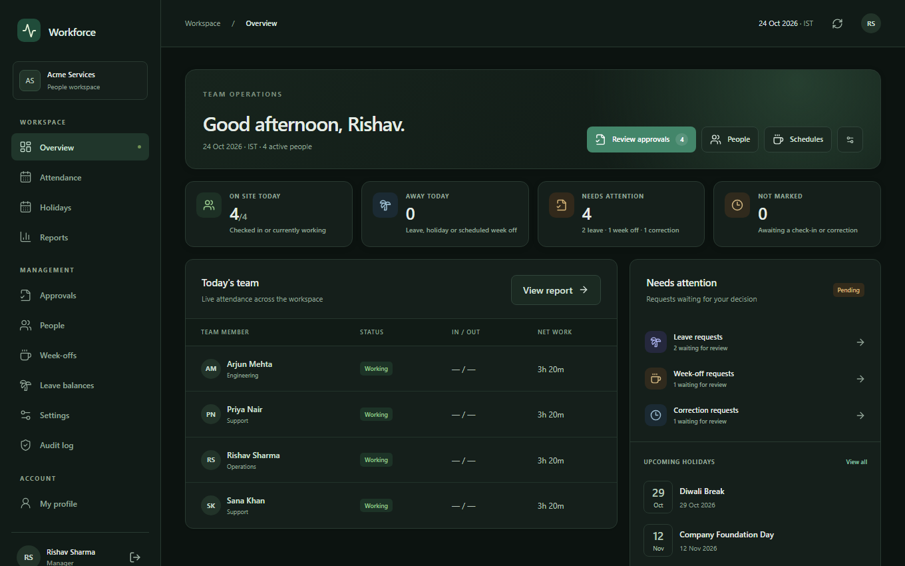
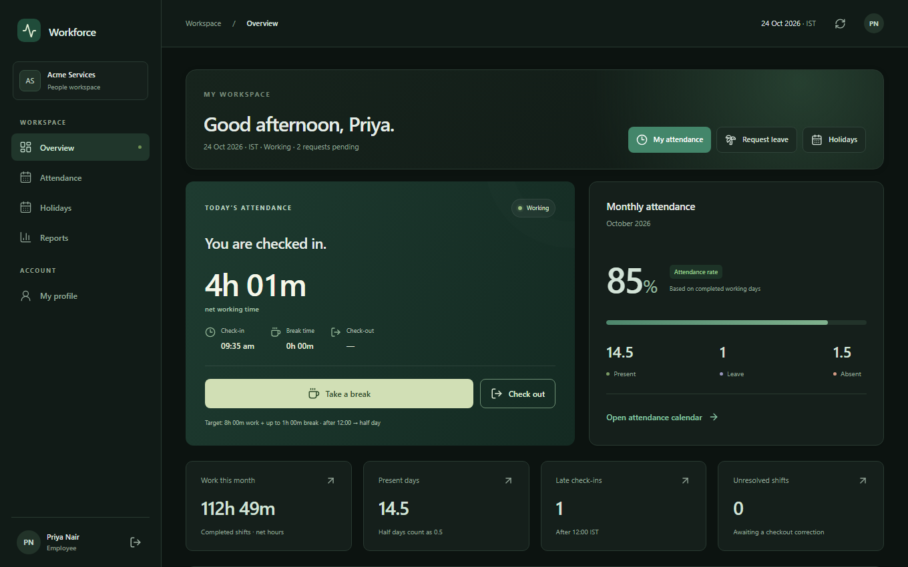
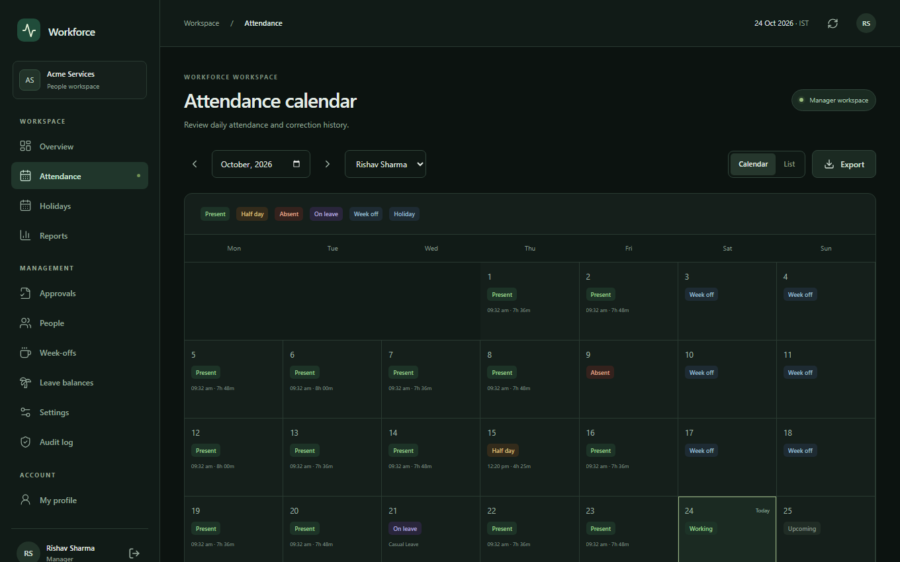
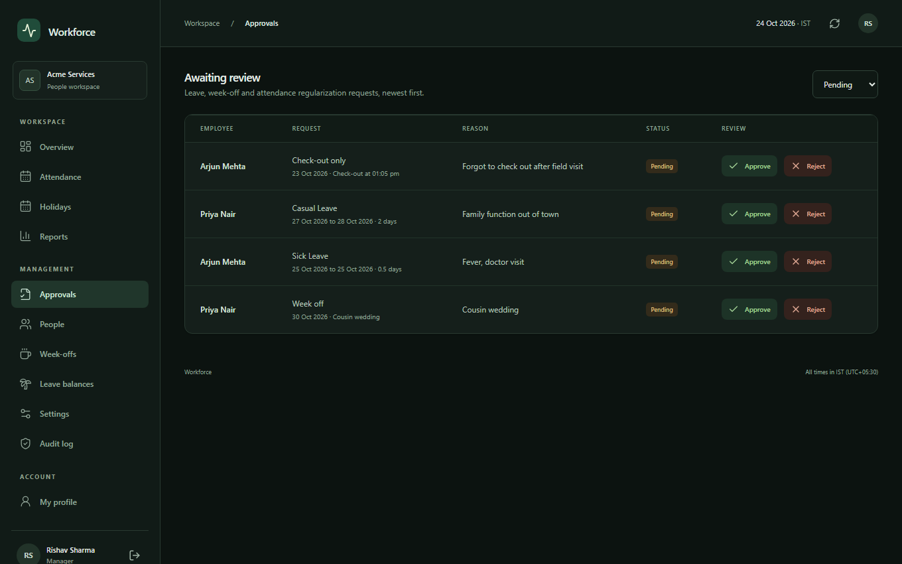
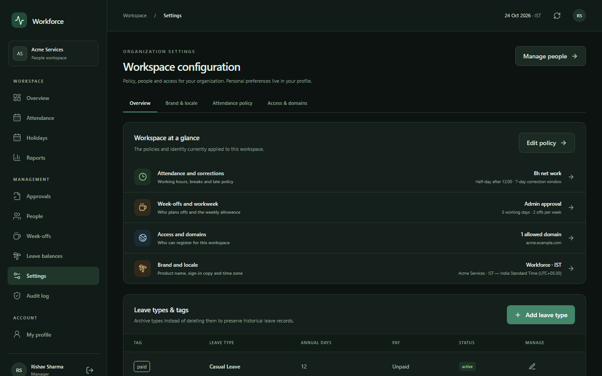

<div align="center">

# Workforce-Management-Platform

**Self-hosted attendance, leave, and week-off management for small and mid-size teams.**

One deployment serves one organization, and everything is rebrandable from the setup wizard.

[](https://react.dev)
[](https://vite.dev)
[](https://tailwindcss.com)
[](https://supabase.com)
[](https://www.postgresql.org)
[](https://recharts.org)
[](https://pglite.dev)
[](https://playwright.dev)
[](https://netlify.com)
[](LICENSE)

[Screenshots](#screenshots) · [Features](#features) · [Deploy](#deploy-in-15-minutes) · [Rules](#attendance-rules) · [Troubleshooting](#troubleshooting) · [Full deploy guide](DEPLOY.md)

</div>

---

## Screenshots

<table>
  <tr>
    <td width="50%" align="center">
      <br />
      <b>Manager command center</b><br />
      <sub>Live team status, KPIs, approval queue, holidays, and policy snapshot.</sub>
    </td>
    <td width="50%" align="center">
      <br />
      <b>Employee workspace</b><br />
      <sub>Live shift card, monthly stats, request status, and weekly hours. No admin controls.</sub>
    </td>
  </tr>
  <tr>
    <td width="50%" align="center">
      <br />
      <b>Attendance calendar</b><br />
      <sub>Present, half day, absent, leave, week-off, holiday, and missing-checkout states.</sub>
    </td>
    <td width="50%" align="center">
      <br />
      <b>Approval inbox</b><br />
      <sub>Leave, week-off, and regularization requests with review notes.</sub>
    </td>
  </tr>
  <tr>
    <td colspan="2" align="center">
      <br />
      <b>Organization settings</b><br />
      <sub>Branding, time zone, attendance policy, workweek pattern, week-off workflow, leave types, and email domains.</sub>
    </td>
  </tr>
</table>

> [!NOTE]
> Screenshots are captured from demo data with `npm run shots`.

## Features

| Area | What you get |
| --- | --- |
| **Access** | Email/password sign-in, optional Google sign-in, Manager and Employee roles |
| **Attendance** | Check-in, check-out, and multiple breaks with instant optimistic feedback |
| **Calendar** | Present, half day, absent, leave, half leave, week off, holiday, missing checkout, not checked in |
| **Regularization** | Check-in only, check-out only, break correction, or full-day correction. Multiple partial requests on the same day |
| **Leave** | Custom types and tags, annual quotas, pending requests reserve balance, manager approval, cancellation rules |
| **Week-offs** | Three policies: employee self-service, employee request with manager approval, or admin-only scheduling |
| **Workweek** | 5 days (2 offs/week), 5.5 days (alternating 6-day and 5-day weeks), or 6 days (1 off/week). Fixed weekdays count toward the allowance, flexible week-offs fill the rest |
| **Profiles** | Photo, birthday, job title, department, contact details, appearance preferences, and all requests in one place |
| **Management** | Command center, approval inbox, people directory, leave balances, holidays, settings, immutable audit trail |
| **Analytics** | Monthly and yearly reports with CSV export |
| **Branding** | Configurable time zone (default `Asia/Kolkata`), fully editable product branding, professional dark theme |
| **Onboarding** | First-run setup wizard: organization name, product name, sign-in copy, logo, support email, time zone, allowed domains |

## Deploy in ~15 minutes

No local install needed. You only need a browser and three free accounts: **GitHub**, **Supabase**, and **Netlify**.

> [!TIP]
> The full illustrated walkthrough is in **[DEPLOY.md](DEPLOY.md)**.

| # | Step | Where |
| :-: | --- | --- |
| 1 | Fork the repo, or use **Use this template** (private is fine) | GitHub |
| 2 | Create a project, then connect your repo copy under **Project Settings → Integrations → GitHub Integration** (working directory `.`, enable **Deploy to production**). The database builds itself from `supabase/migrations/20261024000000_init.sql` | Supabase |
| 3 | Set the manager email and allowed domains in the `settings` table | Supabase |
| 4 | **Add new site → Import an existing project**, build `npm run build`, publish `dist`, add `VITE_SUPABASE_URL` and `VITE_SUPABASE_ANON_KEY` | Netlify |
| 5 | Add the Netlify URL under **Authentication → URL Configuration** | Supabase |
| 6 | Open the site, sign in as the bootstrap manager, finish the setup wizard | Browser |

> [!WARNING]
> Never commit `.env`. Secrets live in Netlify environment variables, so the repository can stay private or public.

## Local development

```bash
cp .env.example .env   # fill VITE_SUPABASE_URL + VITE_SUPABASE_ANON_KEY
npm install
npm run dev            # http://localhost:5173
```

### Profile photos

The initial migration creates a public Storage bucket `avatars` (2 MB, owner-only write). If your project blocks bucket creation, create it manually: name `avatars`, public **on**, MIME types `image/png, image/jpeg, image/webp`.

### Verify

```bash
npm test        # PostgreSQL logic tests with PGlite
npm run build   # type-check and production build
npm run smoke   # preview build, login page check in Chromium, no JS errors
npm run shots   # regenerate docs/images screenshots with mock data
```

## First-run checklist

- [ ] Complete the setup wizard (org name, product name, copy, logo, time zone, domains)
- [ ] **Settings → attendance policy** (defaults: 480 min full day, 240 min half day, 60 min break, 12:00 half-day cutoff)
- [ ] **Settings → week-off policy and workweek pattern** (self-service / approval-required / admin-only)
- [ ] **People**: add employees before they sign up and set fixed weekdays per employee
- [ ] Add holidays, review the seeded leave types (CL, SL, LOP), and set entitlements

## Attendance rules

| Outcome | Rule |
| --- | --- |
| **Full day** | 8 h net work plus up to 1 h break. A check-in after the cutoff caps the day at half day |
| **Half day** | 4+ h net after a late check-in, or 4–8 h on a normal day |
| **Absent** | Below 4 h |
| **Flags** | Excess break is flagged. An open shift is flagged as missing checkout after 20 h |

- Rule values are snapshotted per record, so policy changes never rewrite history.
- Absences are derived at query time. No cron job is needed.

### Regularization

Separate requests exist for check-in only, check-out only, break correction (with optional full break replacement), or full-day correction. Managers approve or reject with a note. Approvals recalculate the day, and the originals stay in the audit trail.

## Troubleshooting

| Problem | Fix |
| --- | --- |
| "The configured bootstrap manager must sign in first" | Sign in with `bootstrap_email`, or update it in `public.settings` |
| "Your email domain is not allowed" | Add the domain to `public.settings.allowed_domains` |
| "Email not confirmed yet" | Open the confirmation link, or disable **Confirm email** in Supabase Auth |
| Login redirects back or the session fails | Check that the Supabase URL configuration includes your site URL |
| "Connect your workspace" screen | `.env` is missing or incorrect. Copy `.env.example` and restart the dev server |
| "Last active manager cannot be removed" | Keep at least one active manager |
| `weekoffs.status does not exist` | The initial migration has not been applied. Check the GitHub integration deployment status in Supabase |

## Tech stack

| Layer | Technology |
| --- | --- |
| Frontend | React 19, Vite 7, Tailwind CSS 4, Recharts |
| Backend | Supabase (PostgreSQL, Auth, RLS, RPC, Storage) |
| Testing | PGlite (database logic), Playwright (smoke tests and screenshots) |
| Hosting | Netlify (static) |

## License

Released under the [MIT License](LICENSE).
